  
  
  
  
  
  

  
  
  
  
  

  
  
  
  
  
  

### Projects

| 项目 | 用途 | 技术栈 | 许可 |
| :--- | :--- | :--- | :--- |
| [Haven Tools](https://github.com/HaltCatch/haven-tools) | 工具箱、HTTP / MCP 与后台任务 | Go · WebAssembly · MCP | [NC¹](https://github.com/HaltCatch/haven-tools/blob/main/LICENSE_SCOPE.md) |
| [Wallpaper Wall](https://github.com/HaltCatch/wallpaper-wall) | 壁纸浏览、收藏与桌面助手 | TypeScript · FastAPI · Rust | [NC¹](https://github.com/HaltCatch/wallpaper-wall/blob/main/LICENSE_SCOPE.md) |
| [Maze Chase](https://github.com/HaltCatch/maze-chase) | 多人 FPS、迷宫与单人跑酷 | Babylon.js · Havok · Colyseus | [NC¹ / 素材原许可](https://github.com/HaltCatch/maze-chase/blob/main/LICENSE_SCOPE.md) |
| [T-Dongle Key](https://github.com/HaltCatch/t-dongle-key) | USB 安全钥匙固件 | ESP32-S3 · C | [AGPL-3.0](https://github.com/HaltCatch/t-dongle-key/blob/main/LICENSE_SCOPE.md) |
| [SublimeGPG](https://github.com/HaltCatch/sublime-gpg) | 编辑器内加密文件与签名 | Python · GnuPG · Sublime Text | [上游 MIT / 修改 NC¹](https://github.com/HaltCatch/sublime-gpg/blob/main/LICENSE_SCOPE.md) |
| [MailHub](https://github.com/HaltCatch/mailhub) | 自托管邮件与收件聚合 | Stalwart · Bulwark · Fetchmail | [NC¹ / 组件原许可](https://github.com/HaltCatch/mailhub/blob/main/LICENSE_SCOPE.md) |

¹ NC：有权许可的原创部分采用 PolyForm Noncommercial；上游代码、依赖及素材保留各自许可。
